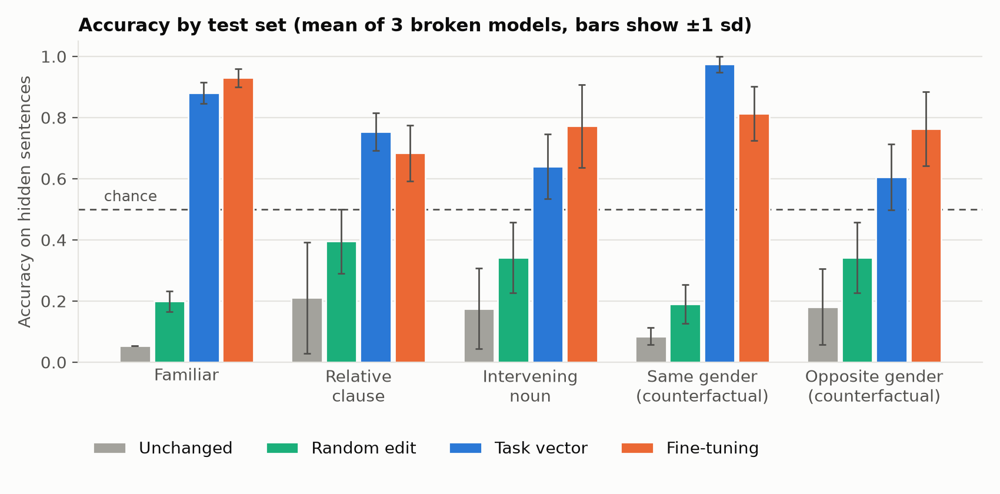
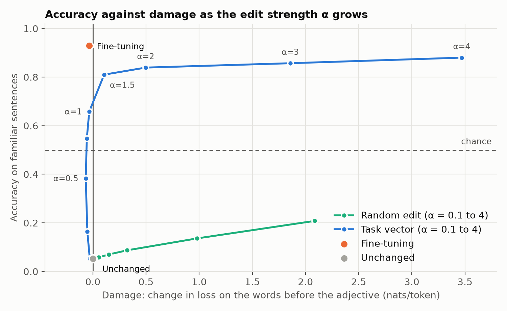

# Research note: can a weight-space edit repair Swedish gender agreement as well as fine-tuning?

## Research Motivation & Hypothesis

The reference article argues that a network's weights can be edited directly to correct behaviour, instead of retraining
the model. They also make a claim that edits "can leave the rest of the model intact and avoid the catastrophic
forgetting that fine-tuning often causes". The article does not test that second claim, and it is based on a very small weight change in one of their experiments.

The basis of this experiment is to investigate with a simple test whether weight-space edits can repair grammatical errors, as well as the untested claim from the article that it can leave the rest of the model intact.

**Hypothesis** 

A task vector derived from matched correct and incorrect agreement models will repair agreement on held-out simple Swedish sentences, including unseen sentence structures, comparably to fine-tuning, while causing less regression on unaffected tokens than fine-tuning.

The article's edits were designed by an AI agent; in its Experiment 8, the agent subtracted one learned direction from a small set of weights. A task vector is also a single direction in weight space, but it is derived automatically, so the experiment needs no agent and can be reproduced easily.

## Experimental Design

**Data** 

The sentences come from a synthetic grammar with 12 common (en) nouns, 12 neuter
(ett) nouns and 12 adjectives, in three structures e.g. 'en bil är röd', 'en bil är mycket röd' & 'en gammal bil är röd'. In the disrupted corpus, only the adjective after 'är' has the wrong form
(e.g. en bil är rött). The article and the attributive e.g. gammal/gammalt stay correct, so the model
can still see gender. This is the case where the article expects an edit to work. Both corpora
contain exactly the same tokens. A quarter of the noun–adjective pairs are held out, split between
development and test.

**Models** 

A decoder-only transformer (1 layer, 32 dimensions, 2 heads) is trained from one shared
initialisation:

- Three broken models are trained on the disrupted corpus.
- Ten matched source pairs are trained, each pair with one run on correct data and one on disrupted data, with the same seed. They are used only to build the task vector.

**Repair methods**

| Method | Description |
|---|---|
| Unchanged | The broken model, as a baseline |
| Task vector | The mean (correct − disrupted) weight difference over the 10 pairs, added to the transformer block weights with strength α |
| Random edit (control) | A random direction of the same size, added with the same α |
| Fine-tuning | Ordinary training of the broken model on the correct corpus |

α (from −1 to 4) and the number of fine-tuning steps (100, 200 or 400) were each chosen by accuracy on the development set alone.

**Evaluation** 

All test sentences are held out. Each model is tested on four sets:

- Familiar structure: noun-adjective pairs e.g. en bil är…
- Relative clause e.g. en bil som står vid ett hus är…
- Intervening noun e.g. en bil nära ett hus är…
- Counterfactual grid: each test noun is placed in a template with an intervening noun of either the same gender or opposite gender, giving four cells. This generates two strategies; a model that agrees with the grammatical subject gets them right, a model that agrees with the nearest noun will flag them incorrectly  e.g. en bil nära ett träd är…

Three measures are used:

- **Accuracy:** how often the correct form is preferred.
- **Margin:** log p(correct) − log p(incorrect).
- **Regression:** the change in loss on every token before the adjective. The adjective itself is excluded, so better agreement cannot hide damage elsewhere.

The broken models start below chance (about 0.05), so damage alone raises their accuracy towards
0.5. That is why accuracy is read together with the margin and the random control.

## Results

The development set selected α = 4 and 400 fine-tuning steps. The figures below are means over the
3 broken models. All results are in `results/comparators/`.

| Method | Familiar | Relative clause | Intervening noun | CF same gender | CF opposite gender | Margin | Regression (Δ nats/token) |
|---|---|---|---|---|---|---|---|
| Unchanged | 0.05 | 0.21 | 0.18 | 0.09 | 0.18 | −4.12 | 0.00 |
| Random edit | 0.20 | 0.40 | 0.34 | 0.19 | 0.34 | −3.24 | +1.98 |
| Task vector (α = 4) | 0.88 | **0.75** | 0.64 | **0.97** | 0.61 | **+5.10** | +3.47 |
| Fine-tuning | **0.93** | 0.68 | **0.77** | 0.81 | **0.76** | +4.40 | **−0.03** |

- The task vector repaired agreement, and the random edit did not. The random edit's margin stayed negative. The repair therefore comes from the direction of the edit, not merely from changing the weights.
- The task vector was better on relative clauses and same-gender cases. It was worse whenever the intervening noun had the opposite gender (0.61–0.64 against 0.76–0.77).
- The task vector raised loss on unaffected tokens by 3.47 nats per token, which is more than the random edit. Fine-tuning caused no regression.

As α increases, the task vector gains accuracy at almost no cost up to α ≈ 1.5 (0.81 accuracy,
+0.11 regression). Past that point, each small gain in accuracy costs a large increase in damage.
No edit strength matches fine-tuning on accuracy and regression together.

**Verdict** 

The hypothesis is rejected:
- Accuracy is only partly comparable to fine-tuning.
- Regression is far greater than fine-tuning's, not smaller.
- The random control is passed.

## Interpretation

-  The broken models scored 0.00 on common-gender sentences, so they applied the agreement rule consistently in reverse. A single direction in weight space can flip such a rule. This supports the article's claim that edits unblock existing abilities.
- The edit strengthened a gender cue, not identification of the subject. Accuracy was close to perfect when both nouns shared a gender (0.97), and fell to 0.61 when they differed. The repaired model agrees with a noun, not reliably with the subject. A test using only same gender sentences would have hidden this.
- Fine-tuning is penalised for damage, and the edit is not. Fine-tuning's loss covers every token, so harm to other tokens is corrected during training. The task vector is computed from other models, and its strength was chosen on agreement accuracy alone. It also carries leftover differences between the source runs, which grow with α along with the fix.
- The article's edits were localised (0.016% of weights in Experiment 8) and designed by an agent. The task vector changes every block parameter. These results show that a broad, averaged edit causes substantial regression. They do not show whether a localised, deliberately designed edit would. This could be further explored with more time and compute power with the agent section of this repository.

**Limitations**
- The model is very small (1 layer) and the grammar is simple and synthetic. Scaling the experiment to a larger model with more complex sentences and real Swedish sentences may significantly alter the results.
- The sample sizing across the experiment was small, and future work would benefit from increasing the sample sizes for more generalisable results.
- Both selected settings lie at the edge of their search range, and so improvements could be seen with a more extnesive setting selection.
- Shared initialisation is rarely available when repairing a model, but was necessary for the design of this experiment.

## Recommendation

1. Use traditional model fine-tuning to correct known faults when correct data exists. It was as accurate or more accurate on the hardest cases, cheaper, and caused no regression. Averaged weight edits are not inherently a lower risk alternative as the article suggests, although this experiment has proved its an interesting alternative avenue to explore.
2. Evaluate every repair for regression and shortcuts, not accuracy alone. Choose settings under a stated regression limit. Including opposite gender counterfactuals in Swedish grammar tests is shown to be beneficial diagnositcally and for evaluation purposes.
3. Next steps, with more time and computing power would be to test localised, agent designed edits, replicating the methodology in the original article, and running the same set of evaluations to gain a better insight closer aligned to the conclusions from the article.

The repository includes a harness in which an LLM agent edits the weights under a forwardpass budget, following Experiment 8 in the article. It has only been run as a single demonstration with a small local model (`results/agent_demo_qwen3-4b-think/`) for my curiosity and engagement in the project, but the results are not recorded or evaluated here as they are not complete.

Running it with a frontier model at budgets of 10, 25 and 50 passes, scored with the same measures, would be a better test of the article's claim.
